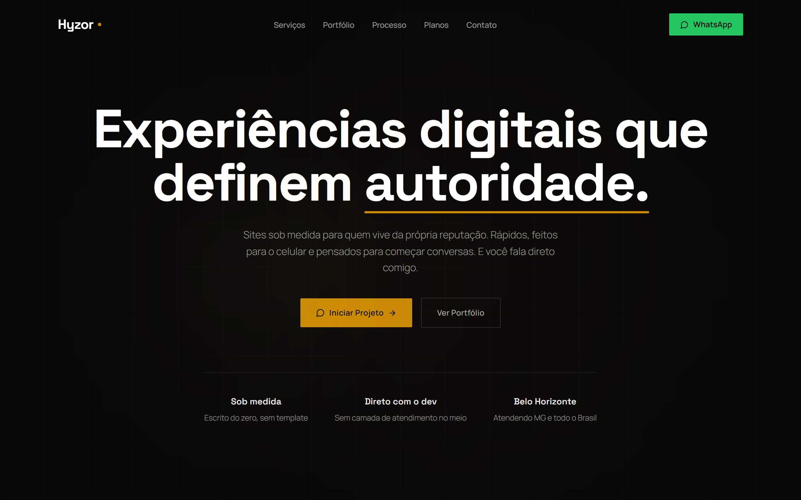
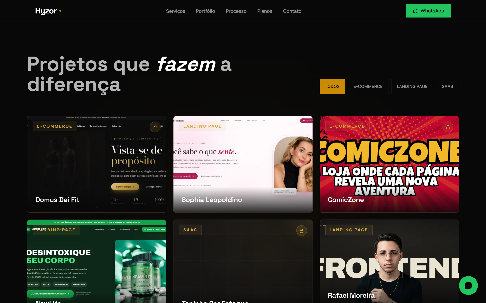

# Hyzor Digital

**Experiências digitais que definem autoridade.**

Sites sob medida para quem vive da própria reputação. 
Rápidos, feitos para o celular e pensados para começar conversas.

[**hyzor.com.br**](https://hyzor.com.br) · [WhatsApp](https://wa.me/5531992479530) · [contato@hyzor.com.br](mailto:contato@hyzor.com.br)

 

---

## O que eu faço

| | |
| --- | --- |
| **Landing Pages** | Uma página só, com um objetivo só: fazer quem chegou virar conversa no WhatsApp. |
| **Sites Institucionais** | O site que mostra quem você é e como trabalha, para o cliente decidir antes mesmo de falar com você. |
| **Lojas Virtuais** | Catálogo, carrinho e pagamento de verdade, cartão e no PIX, com painel para você gerenciar sozinho. |
| **Sistemas sob medida** | Quando o trabalho não cabe numa planilha: sistema feito para o seu jeito, com níveis de acesso e painel. |
| **Manutenção & Suporte** | Seu site no ar, atualizado e seguro. Você não precisa aprender nada disso. |

Cada projeto é escrito do zero, sem template, e você fala direto com quem desenvolve.

## Projetos

- **Domus Dei Fit**: loja virtual completa, do catálogo ao pagamento com cartão e PIX, com painel administrativo.
- **Sophia Leopoldino**: landing page para psicóloga clínica, com acolhimento e confiança na primeira dobra.
- **ComicZone**: loja de quadrinhos com três níveis de acesso num só sistema.
- **NewLife**: landing page de vendas com caminho direto do anúncio ao WhatsApp.
- **Toninho Car Estoque**: app de controle de estoque para mecânica, usado pelo celular.

O portfólio completo está em [hyzor.com.br/#portfolio](https://hyzor.com.br/#portfolio).

## Como eu trabalho

1. **Descoberta & Estratégia**: entendo seu trabalho, quem é seu cliente e o que a página precisa provar para ele.
2. **Design & Prototipagem**: você vê o desenho da página antes de existir código.
3. **Desenvolvimento**: o site é escrito do zero, para poder crescer depois sem recomeçar.
4. **Lançamento & Testes**: testado em celular, tablet e computador antes de ir ao ar.
5. **Suporte & Evolução**: depois da entrega, você continua falando comigo.

## Feito para o celular

## Sobre este repositório

Este repositório é uma vitrine. O código-fonte do site é privado.

O site é construído com React, Vite e Tailwind CSS, com páginas pré-renderizadas para carregar rápido e serem encontradas no Google.

---

**Hyzor Digital** · Belo Horizonte, MG · Atendendo MG e todo o Brasil 
Seg–Sex, 9h–18h

© Hyzor Digital. Todos os direitos reservados.

